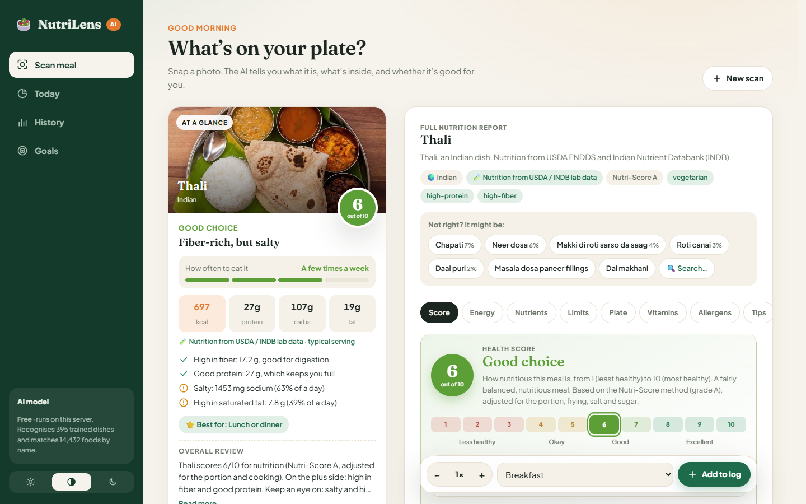
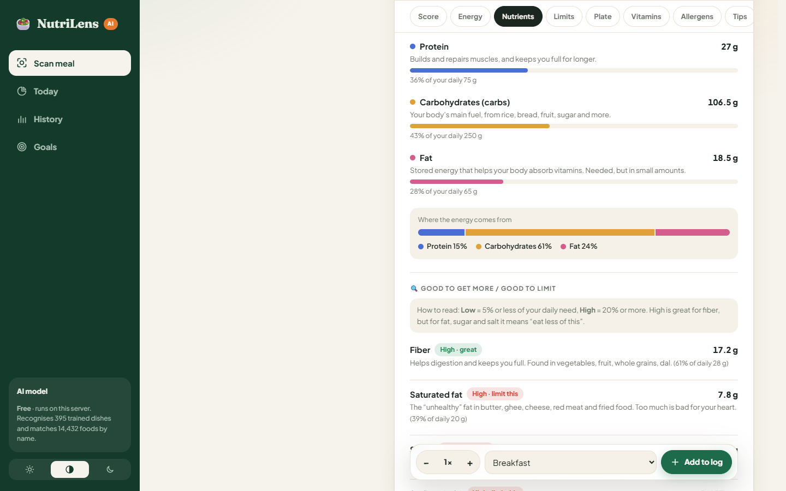
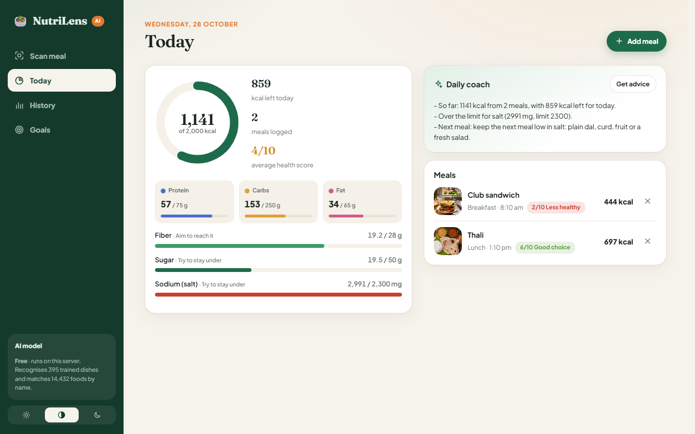
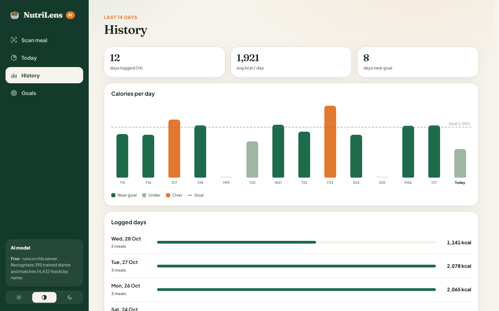
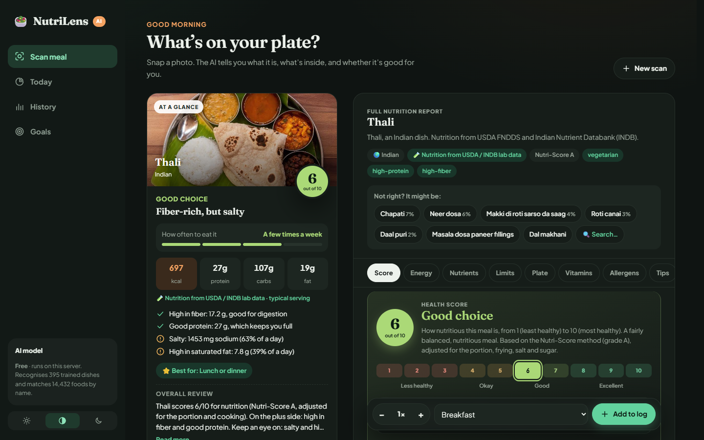
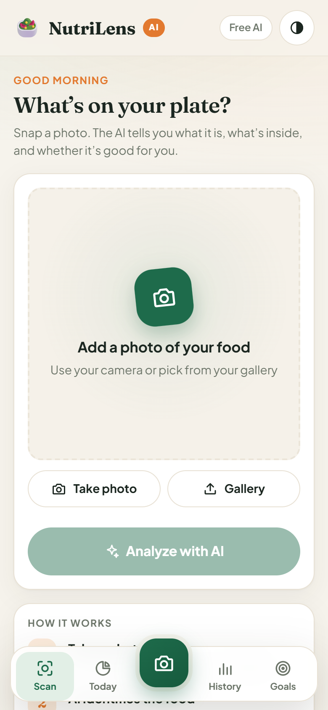
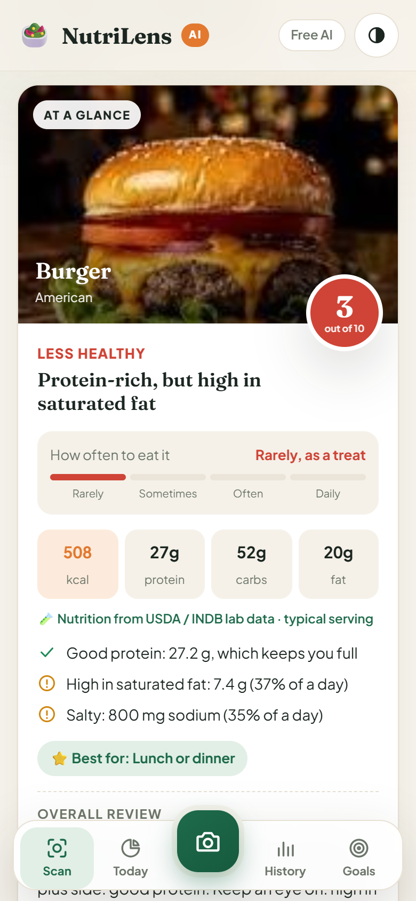
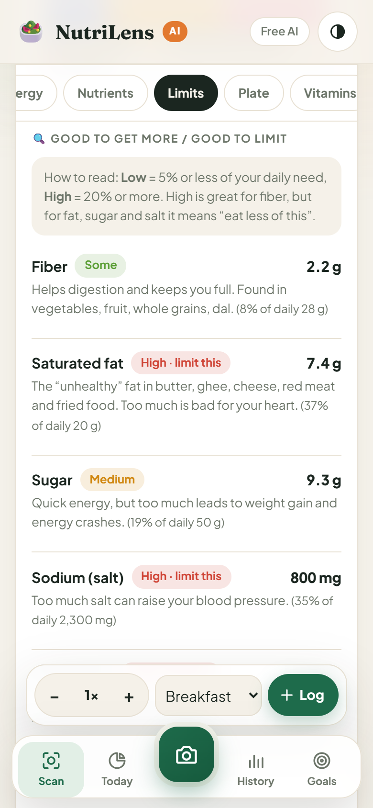
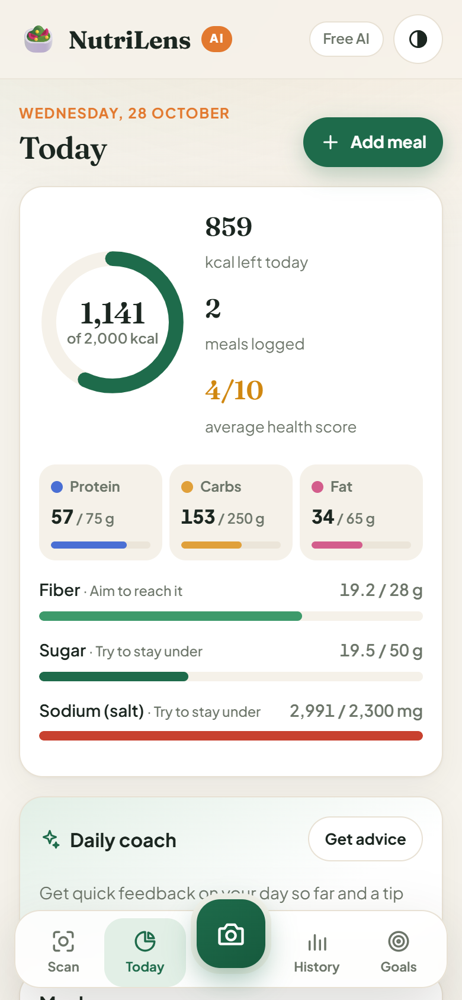

<div align="center">

# 🥗 NutriLens

**Snap a photo of your meal. A free, self-hosted AI tells you what it is, what's inside, and whether it's good for you, in words anyone can understand.**

    



</div>

---

## What it does

1. **Take a photo** of your food, using your phone camera or a file on your computer.
2. **A food-recognition model names the dish.** It's an open-source vision model (CLIP) plus a classifier trained on 44,502 free food photos covering 395 dishes from around the world, including 268 Indian dishes. Anything else is matched by name against 6,000+ foods.
3. **Nutrition comes from real datasets:** USDA FoodData Central and the Indian Nutrient Databank (INDB), for a typical serving that you can adjust.
4. **You get a clear report:**
   - a **health score** from 1 to 10 (Nutri-Score method, adjusted for the portion, frying, salt and sugar), with the reasons
   - a one-line verdict and **how often** you could eat the meal
   - calories, protein, carbs and fat, plus fiber, sugar, salt and vitamins, each explained in plain language
5. **Not right? Fix it in one tap:** pick from the suggestions, search for the right food, or add and remove foods. It's free and instant.
6. **Log it** and track your day against your goals.

There are **no API costs**: the model runs on your own computer or server. Every number shows where it came from.

## Screenshots

### Desktop

| Full report: every nutrient explained | Today: progress and daily coach |
|---|---|
|  |  |
| **History: 14 days against your goal** | **Dark mode** |
|  |  |

### Phone

Works like an app: a camera button in the tab bar, a section bar for the long report, and it can be installed to your home screen.

| Home | At a glance | Report sections | Today |
|---|---|---|---|
|  |  |  |  |

## Features

**Food recognition (free, runs locally)**
- Recognises 395 trained dishes: Food-101 (world dishes), 268 Indian dishes, 30 Vietnamese and 11 Malaysian
- Foods outside the trained list are matched by name against 6,000+ USDA and INDB dishes
- Rejects photos that aren't food
- Shows how sure it is, plus the next most likely dishes as one-tap suggestions

**Nutrition from datasets**
- Calories, protein, carbs, fat, saturated fat, fiber, sugar, sodium and cholesterol, per item and in total
- Vitamins and minerals (calcium, iron, magnesium, potassium, vitamins A, B12, C and D), with what each does and the % of your daily need
- Every food links to its source entry. When no dataset has a dish (some regional sweets and Vietnamese dishes), a similar food is used and clearly marked **≈ similar dish**
- Meals made of several parts are built from their parts, e.g. a thali = rice + dal + roti + vegetable curry + curd

**The report**
- **Health score (1–10)** from the Nutri-Score method, adjusted for portion, frying, salt, sugar and rich or creamy dishes, with "What's good" and "Watch out" reasons
- **At a glance** card: a one-line verdict, how often to eat it (Rarely → Daily), what it's best for, and an overall review
- Possible allergens, diet tags (vegan, vegetarian, high-protein…) and 3 tips to make the meal healthier
- **Honest accuracy:** a likely calorie range, how sure the model is, what it recognised, and its assumptions

**Tracking**
- Change the portion (0.25× to 10×), add or remove foods, or search 14,000+ foods
- Daily log with breakfast, lunch, dinner and snacks, a calorie ring, and macro and limit progress bars
- 14-day history chart and a 30-day list; personal daily goals, each with a plain-language hint
- **Daily coach:** feedback on your day and a suggestion for your next meal

**Experience**
- Responsive: sidebar layout on desktop, app-style tab bar on phone, wide strip on tablet
- Light, dark and auto themes; installable web app with its own home-screen icon
- Optional phone access over your Wi-Fi, protected by a PIN

## Getting started

**You need:** [Node.js](https://nodejs.org) 22.13 or newer. **No API key is needed.**

```bash
git clone https://github.com/NISHVAN777/Nutrition-Tracker.git
cd Nutrition-Tracker
npm install
npm start
```

The first `npm start` downloads the vision model (89 MB, pinned version, checksum-verified). Then open **http://localhost:8787**. On Windows you can also double-click `start.bat`.

## How the food recognition works

```
Photo ──► browser resizes to 1024 px JPEG ──► POST /api/analyze
                                                  │
                     CLIP image encoder (ONNX, runs on the server CPU, ~0.1 s)
                                                  │
              ┌───────────────────────────────────┼───────────────────────────────┐
     food / not-food check        trained classifier (395 dishes)    name matching (6,168 foods)
              └───────────────────────────────────┼───────────────────────────────┘
                                                  │
           dish ──► its parts and grams ──► USDA / INDB values per 100 g × grams
                                                  │
         Nutri-Score + rules ──► score, verdict, reasons, tips, allergens, tags
                                                  │
                                       report in the browser
```

### The model

| Part | What it is |
|---|---|
| Image encoder | [CLIP ViT-B/32](https://github.com/openai/CLIP) (MIT license), ONNX 8-bit version from [Xenova/clip-vit-base-patch32](https://huggingface.co/Xenova/clip-vit-base-patch32) |
| Classifier | Multinomial logistic regression trained on CLIP embeddings of 44,502 photos (`ml/classifier.f32`, 791 KB) |
| Name matching | CLIP text embeddings of 6,168 FNDDS and INDB dish names (`ml/vocab.i8`) |
| Runtime | [Transformers.js](https://github.com/huggingface/transformers.js) in Node, about 300 MB of memory |

### Accuracy

Measured on **8,120 test photos the model never saw during training:**

| Test set | Top-1 (first guess right) | Top-5 (right dish among the suggestions) |
|---|---|---|
| **All 395 dishes** | **80.6%** | **95.9%** |
| Food-101 (101 world dishes) | 84.5% | 96.7% |
| Indian (268 dishes) | 70.3% | 93.8% |
| Vietnamese (30 dishes) | 80.9% | 96.4% |
| Malaysian (11 dishes) | 78.1% | 93.9% |

The model's confidence is meaningful: when it says **high** (63% of photos), the first guess is right **95%** of the time; **medium** 69%; **low** 47%. Below that, it falls back to matching by name.

Real-life photos (mixed plates, unusual angles) are harder than dataset photos, which is why the app always shows its next guesses and lets you correct it in one tap.

### Training data

| Dataset | Dishes | Photos used | Source |
|---|---|---|---|
| Food-101 | 101 world dishes | up to 200 per dish + 50 test | [ethz/food101](https://huggingface.co/datasets/ethz/food101) (ETH Zurich) |
| Indian food images | 268 Indian dishes | up to 50 per dish | [snow3751/Indian_food_images](https://huggingface.co/datasets/snow3751/Indian_food_images) |
| Vietnamese food images | 30 dishes | up to 150 per dish | [TuyenTrungLe/vietnamese_food_images](https://huggingface.co/datasets/TuyenTrungLe/vietnamese_food_images) |
| Malaysian food images | 11 dishes | up to 150 per dish | [lowyisan/malaysian_food_images](https://huggingface.co/datasets/lowyisan/malaysian_food_images) |

No photos are stored in this repository, only the trained weights. Dishes that appear in several datasets (pizza, samosa, fried rice…) are merged.

### Retrain it yourself

Training runs on an ordinary laptop CPU (no GPU needed): about an hour for the embeddings and a minute for the classifier.

```bash
npm run ml:download     # CLIP text encoder + Indian photos (Food-101/Vietnamese/Malaysian are streamed)
npm run ml:embed        # CLIP embeddings of every photo (resumable)
npm run ml:train        # trains the classifier, prints test accuracy -> ml/classifier.*
npm run ml:labels       # links each dish to its nutrition entry -> ml/labels.json, vocab, gate
```

Which nutrition entry each dish uses is hand-checked in [`scripts/ml/food-overrides.json`](scripts/ml/food-overrides.json).

## Data sources

Nutrition values come from `datasets/foods.db` (3.9 MB, 14,432 foods), built by `scripts/build-foods-db.mjs`:

| Dataset | Foods | What it covers |
|---|---|---|
| USDA FNDDS 2021–2023 | 5,431 | Dishes as people eat them, incl. dal, sambar, biryani, idli, dosa, naan |
| USDA SR Legacy | 7,793 | Foods and ingredients |
| USDA Foundation Foods (2026-04) | 321 | Newest, most detailed lab analyses |
| INDB, Indian Nutrient Databank | 887 | Indian recipes such as butter chicken, masala dosa, rajma, kheer |

INDB's 127 deep-fried recipes are left out: they count all the frying oil as eaten (40–85 g fat per 100 g), so USDA values are used for fried foods instead.

> U.S. Department of Agriculture, Agricultural Research Service. FoodData Central. [fdc.nal.usda.gov](https://fdc.nal.usda.gov)
> Indian Nutrient Databank (INDB). [github.com/lindsayjaacks/Indian-Nutrient-Databank-INDB-](https://github.com/lindsayjaacks/Indian-Nutrient-Databank-INDB-)

## Use it on your phone

1. In `.env`, set `LAN_ACCESS=true` and choose an `ACCESS_PIN` (at least 6 characters).
2. Restart the server. It prints the address to use, e.g. `Open on your phone: http://192.168.1.20:8787`.
3. On your phone (same Wi-Fi), open that address and enter the PIN. The phone stays logged in for 30 days.
4. Optional: tap **Add to Home Screen** (Safari's Share menu, or Chrome's ⋮ menu) to install it like an app.

- The first time, Windows Firewall may ask whether Node.js can use the network: allow it on **private** networks only.
- The camera button works over plain `http://` because it uses the phone's photo picker, not a live camera stream.

## Deploy to Fly.io

The repo includes a `Dockerfile` and `fly.toml` for a small, cheap setup:

- one shared-CPU machine with 512 MB of memory, in Singapore (`sin`)
- the machine **sleeps when idle** and wakes on the next visit in a few seconds
- a 1 GB encrypted volume for the database and photos, with daily snapshots
- HTTPS only, and the clock is set to India time so "today" resets at midnight IST
- the model is downloaded and checksum-verified while the image is built

```bash
fly apps create <your-app-name>
fly volumes create nutrilens_data --region sin --size 1
fly deploy --ha=false
```

Change `app` in `fly.toml` to your app name first. Login is controlled by `REQUIRE_LOGIN` in `fly.toml`: `"true"` asks every visitor for the `ACCESS_PIN` secret; `"false"` lets anyone with the link use it, and search engines are asked not to index it.

## Configuration

All settings are optional and live in `.env` (git-ignored). See [`.env.example`](.env.example).

| Setting | Default | What it does |
|---|---|---|
| `AI_ENGINE` | `local` | `local` = free self-hosted model; `grok` = paid xAI Grok vision (optional) |
| `PORT` | `8787` | Server port |
| `LAN_ACCESS` / `ACCESS_PIN` | `false` / (empty) | Optional phone access over Wi-Fi, behind a PIN |
| `DATA_DIR` | `./data` | Where your meal log and photos are stored |
| `PER_MINUTE_LIMIT` | `6` | Scans per minute per visitor (the free engine allows at least 20) |
| `XAI_API_KEY`, `XAI_MODEL`, `DAILY_AI_LIMIT`, `MONTHLY_BUDGET_USD` | | Only for `AI_ENGINE=grok`: key, model and hard spending caps |

## Security

- Uploads are checked for type and file signature and capped at 2 MB; rate limits apply per visitor.
- By default the server listens on `127.0.0.1` only. Phone access and the hosted version can require a PIN (HttpOnly SameSite=Strict cookies, constant-time check, lockout after repeated wrong PINs).
- A strict Content-Security-Policy allows no third-party scripts, and all text is HTML-escaped before display.
- The model file is pinned to an exact version and verified by SHA-256 before use.
- With the optional Grok engine, the API key stays on the server and is never sent to the browser.

## Project structure

```
server/
  index.js     Express API: scans, corrections, food search, log, goals, optional PIN login
  vision.js    Food recognition: CLIP + trained classifier + name matching + food check
  compose.js   Builds the report from foods and grams
  rules.js     Nutri-Score, verdicts, reasons, tips, allergens, diet tags, daily coach
  foods.js     Nutrition database (USDA + INDB): search, per-100 g scaling, vitamins
  ai.js        Optional paid Grok engine
  db.js        SQLite via Node's built-in node:sqlite
public/        App (vanilla HTML/CSS/JS, no build step), installable web app
ml/            Trained classifier, dish labels, name-matching vocabulary
datasets/      foods.db nutrition database
scripts/       fetch-model, build-foods-db, ml/ (download, embed, train, labels)
docs/screenshots/
```

## Accuracy note

Nutrition values are **estimates from a photo**. The dish can be misrecognised, and portions vary, which is why the app uses a typical serving that you can adjust. NutriLens is a guide for everyday awareness, not medical or dietary advice.

## Roadmap

- Barcode scanning for packaged food (free Open Food Facts lookup)
- Recognising several separate foods on one plate
- Learning from your corrections to improve the model
- Water and weight tracking
